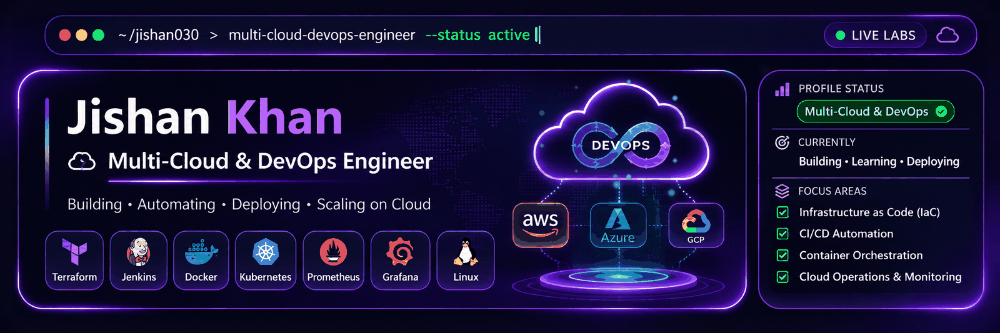
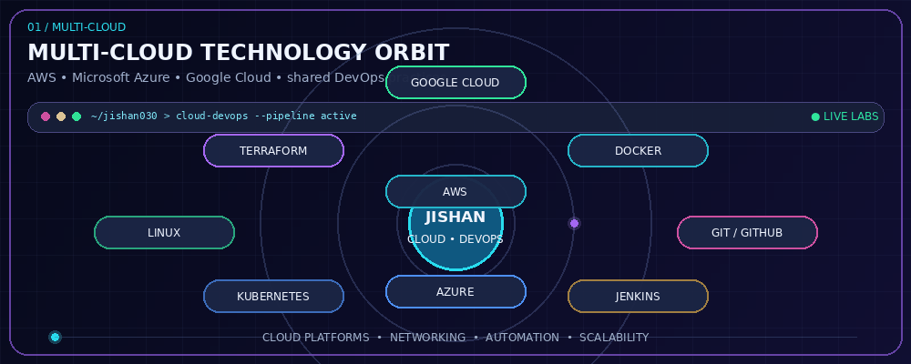
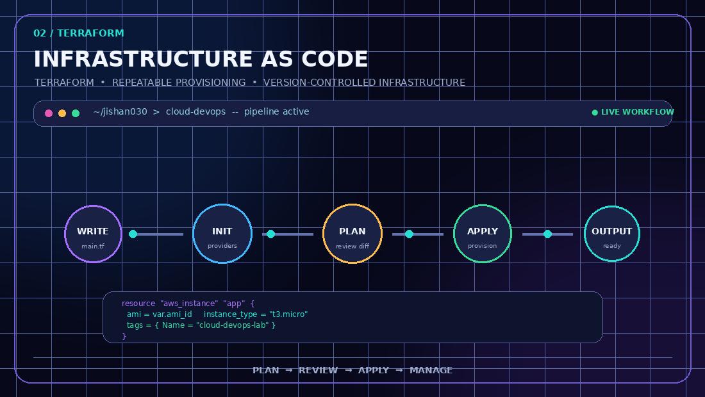
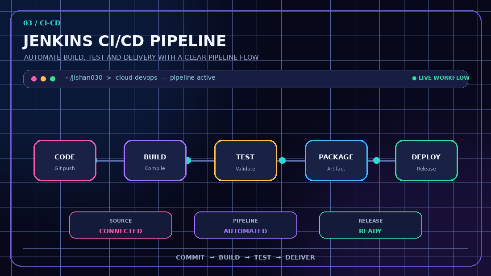
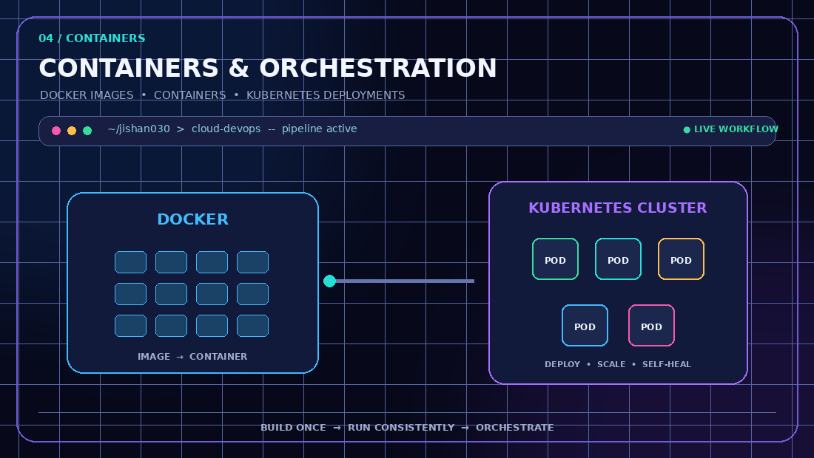
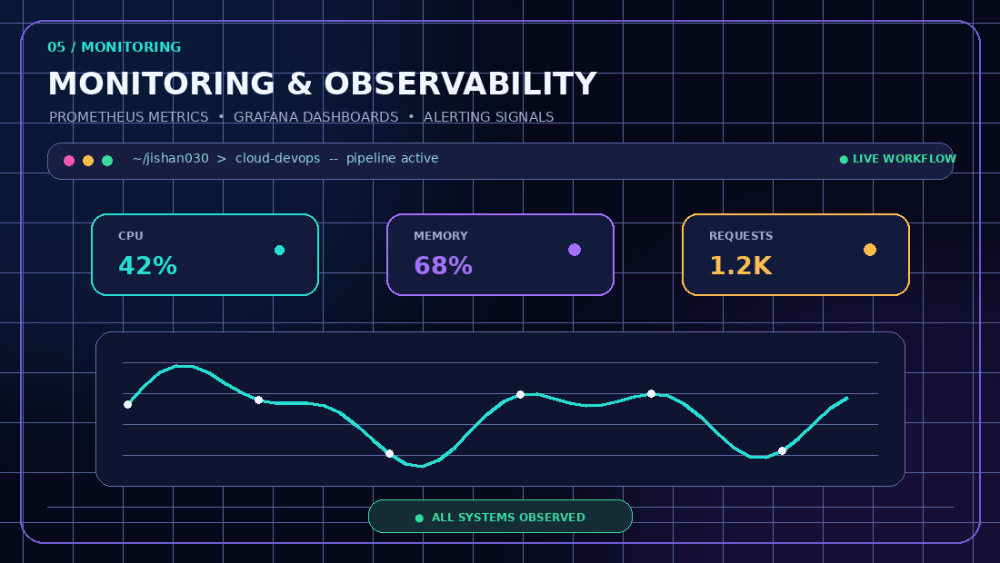

<div align="center">



# ☁️ Jishan Khan

### 🚀 Multi-Cloud & DevOps Engineer

**Building • Automating • Deploying • Scaling on Cloud**

<p>
<a href="https://github.com/jishan030">

</a>
<a href="https://www.linkedin.com/in/jishan-khan-069234258">

</a>
</p>


</div>

---

## 👨‍💻 About Me

I'm a Computer Science graduate focused on **Cloud Computing, Multi-Cloud Technologies and DevOps Engineering**.

I enjoy building cloud infrastructure, automating deployments, managing servers and exploring modern DevOps practices through hands-on projects.

* ☁️ Practicing AWS cloud infrastructure and services.
* 🏗️ Building Infrastructure as Code projects using Terraform.
* ⚙️ Practicing CI/CD pipelines with Jenkins.
* 🐳 Working with Docker and containerization.
* 🐧 Linux administration and server troubleshooting.
* 📊 Exploring monitoring using Prometheus and Grafana.
* 🌐 Expanding my knowledge of Microsoft Azure and Google Cloud.
* 🚀 Building practical cloud and DevOps projects.

**My Approach:** Learn → Practice → Build → Automate → Deploy → Monitor

---

## 🌐 01. Multi-Cloud Technology Orbit

<div align="center">



</div>

---

## 🏗️ 02. Infrastructure as Code | Terraform

<div align="center">



</div>

---

## ⚙️ 03. CI/CD Automation | Jenkins

<div align="center">



</div>

---

## 🐳 04. Containerization | Docker & Kubernetes

<div align="center">



</div>

---

## 📊 05. Monitoring & Observability

<div align="center">



</div>

---

## 🛠️ Technical Skills & Tools

### ☁️ Cloud Platforms

<p>


</p>

### 🏗️ Infrastructure as Code

<p>


</p>

### ⚙️ CI/CD & Version Control

<p>


</p>

### 🐳 Containers & Orchestration

<p>


</p>

### 📊 Monitoring & Observability

<p>


</p>

### 🐧 Operating Systems & Scripting

<p>


</p>

### 🌐 AWS Services & Networking

`EC2` `IAM` `VPC` `S3` `RDS` `SSM` `ALB` `NLB` `CloudFront` `CloudWatch` `Subnets` `CIDR` `Security Groups`

---

## 🚀 Featured Projects

<table>
<tr>
<td width="50%" valign="top">

### 📚 Bookverse – Terraform AWS Infrastructure

A three-tier AWS infrastructure project built using Terraform modules.

**Key Highlights**

* Modular Terraform architecture
* VPC and subnet configuration
* Public and private EC2 instances
* Load balancer configuration
* Security groups and networking
* Infrastructure provisioning using Terraform

<a href="https://github.com/jishan030/bookverse-terraform-aws">

</a>

</td>
<td width="50%" valign="top">

### ☁️ CloudStore – AWS Cloud Project

A cloud-based application deployment project integrating frontend, backend and AWS infrastructure.

**Key Highlights**

* React.js frontend
* Node.js and Express backend
* AWS EC2 deployment
* RDS database integration
* Nginx configuration
* Cloud infrastructure troubleshooting

<a href="https://github.com/jishan030/cloudstore_aws_project">

</a>

</td>
</tr>
</table>

---

## ⚙️ DevOps Hands-on Practice

| Technology   | Practical Focus                                    |
| ------------ | -------------------------------------------------- |
| AWS          | EC2, IAM, VPC, S3, RDS, ALB, NLB, SSM              |
| Terraform    | Modules, Infrastructure Provisioning, Environments |
| Jenkins      | CI/CD Pipeline Practice                            |
| Docker       | Containerization and Deployment                    |
| Linux        | Server Administration and Troubleshooting          |
| Networking   | CIDR, Subnets, Routing and Security Groups         |
| Monitoring   | Prometheus, Grafana and CloudWatch                 |
| Git & GitHub | Version Control and Repository Management          |

---

## 🗺️ My Cloud & DevOps Engineering Journey

```text
              MULTI-CLOUD
                   |
           AWS • AZURE • GCP
                   |
                   ▼
       INFRASTRUCTURE AS CODE
               TERRAFORM
                   |
                   ▼
            CI/CD PIPELINES
                JENKINS
                   |
                   ▼
          CONTAINERIZATION
          DOCKER • KUBERNETES
                   |
                   ▼
          MONITORING & LOGS
        PROMETHEUS • GRAFANA
                   |
                   ▼
          CLOUD AUTOMATION
                   |
                   ▼
         REAL-WORLD PROJECTS
                   |
                   ▼
              🚀 GROWING
```

---

## 📊 GitHub Statistics

<div align="center">


<br/><br/>


</div>

---

## 🎯 Currently Focusing On

| Area          | Focus                                           |
| ------------- | ----------------------------------------------- |
| ☁️ Cloud      | AWS infrastructure and multi-cloud fundamentals |
| 🏗️ IaC       | Terraform and OpenTofu                          |
| ⚙️ CI/CD      | Jenkins automation                              |
| 🐳 Containers | Docker and Kubernetes                           |
| 🐧 Linux      | Administration and troubleshooting              |
| 📊 Monitoring | Prometheus and Grafana                          |
| 🌐 Networking | Cloud networking and connectivity               |
| 🚀 Projects   | Infrastructure automation and deployment        |

---

## 📫 Let's Connect

<div align="center">

<a href="https://www.linkedin.com/in/jishan-khan-069234258">

</a>

<a href="https://github.com/jishan030">

</a>

</div>

---

<div align="center">

### ⚡ BUILDING THE FUTURE WITH CLOUD & DEVOPS

**Learn • Build • Automate • Deploy • Scale**

</div>
